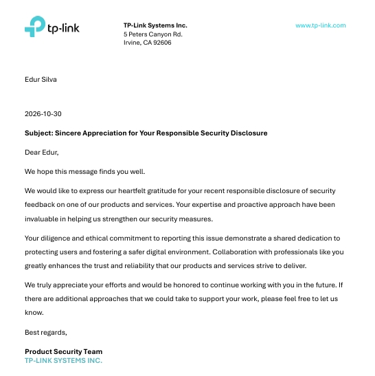

<h1 align="center">👨‍💻 Bruno — Pesquisador Hacker</h1>

  Explorando segurança ofensiva, automações e infraestrutura.

---

<h2>Sobre</h2>

  Nos últimos meses venho dedicando tempo à pesquisa de segurança,
  identificação e reporte de possíveis vulnerabilidades em programas
  públicos e privados — de aplicações web e APIs a smart contracts DeFi,
  além de contribuições em projetos open source (de OpenSSL, Protocol Buffers,
  libpcap e libavif ao kernel Linux) e participação em CTFs e VDPs.

[]

  Este projeto reúne informações públicas relacionadas à trajetória
  de <strong>sucloudflare0x00</strong> em segurança da informação.

  Os números apresentados nesta página correspondem aos registros
  públicos disponíveis nas respectivas plataformas e podem ser
  atualizados conforme novas submissões sejam analisadas.

---

<h2>Números registrados</h2>

  

    7
    Vulnerabilidades reportadas
  

  

    70%
    Accuracy
  

  

    1
    Validada e resolvida
  

  

    5
    Badges / achievements
  

---

<h2>Plataformas</h2>

  

    <h3>📍 Bugcrowd</h3>
    
@sucloudflare0x00

    <ul>
      <li>7 vulnerabilidades reportadas</li>
      <li>70% de accuracy</li>
      <li>Submission Shogun — Level 2</li>
      <li>Bounty Bee — Level 2</li>
      <li>Foco em Web Application e API Testing</li>
    </ul>
    

      <a href="https://bugcrowd.com/" target="_blank" rel="noopener noreferrer">Perfil Bugcrowd</a>
    

  

  

    <h3>📍 HackerOne</h3>
    
@sucloudflare0x00

    <ul>
      <li>Vulnerabilidade registrada como validada e resolvida no Gogo VDP</li>
      <li>Report #3858295 — IDOR crítico na Coinbase Developer Platform (cross-project MFA config leak), aprovado em revisão preliminar</li>
      <li>Badge: Insecticide</li>
      <li>Badge: TrailBlazer</li>
      <li>Badge: Good Samaritan</li>
      <li>Atuação em pesquisa de vulnerabilidades</li>
    </ul>
    

      <a href="https://hackerone.com/sucloudflare0x00" target="_blank" rel="noopener noreferrer">Perfil HackerOne</a>
    

  

---

<h2>🏅 Reconhecimentos</h2>

<table>
  <thead>
    <tr>
      <th>Data</th>
      <th>Organização</th>
      <th>Reconhecimento</th>
    </tr>
  </thead>
  <tbody>
    <tr>
      <td>30/10/2026</td>
      <td><strong>TP-Link Systems Inc.</strong></td>
      <td>
        Carta de agradecimento do <em>Product Security Team</em> pela divulgação responsável
        de feedback de segurança sobre um de seus produtos e serviços, destacando a
        diligência, o compromisso ético e a proatividade na comunicação do problema.
      </td>
    </tr>
  </tbody>
</table>

  
   
  Carta de agradecimento da TP-Link Systems Inc. — Product Security Team (30/10/2026)

---

<h2>🔐 Vulnerabilidades e achados de segurança</h2>

<table>
  <thead>
    <tr>
      <th>Alvo</th>
      <th>Achado</th>
      <th>Status</th>
    </tr>
  </thead>
  <tbody>
    <tr>
      <td><strong>mdbtools</strong></td>
      <td>Heap buffer overflow (off-by-one) em <code>mdb-sql</code> (<code>src/util/mdb-sql.c</code>) via arquivo <code>.sql</code> malicioso; confirmado com AddressSanitizer (duas variantes de gatilho) e patch de uma linha proposto</td>
      <td>Corrigido no upstream (branch <code>dev</code>, commit <code>3d19ef5</code>); tratado pelo mantenedor como bugfix comum, sem CVE; crédito na mensagem do commit (GHSA-v65c-2xmr-6vh2) e nas notas do próximo lançamento</td>
    </tr>
    <tr>
      <td><strong>TP-Link</strong></td>
      <td>Divulgação responsável de feedback de segurança sobre produto/serviço da empresa</td>
      <td>Carta de agradecimento recebida do Product Security Team (30/10/2026)</td>
    </tr>
    <tr>
      <td><strong>Coinbase Developer Platform</strong></td>
      <td>IDOR crítico — leitura de configuração MFA de outro projeto usando cookie de sessão alheio (HackerOne #3858295)</td>
      <td>Aprovado em revisão preliminar</td>
    </tr>
    <tr>
      <td><strong>NASA Launchpad (sandbox)</strong></td>
      <td>Login CSRF</td>
      <td>Submetido via Bugcrowd</td>
    </tr>
    <tr>
      <td><strong>Google Gemini</strong></td>
      <td>Prompt Injection + alucinação de ferramentas fictícias + information disclosure de arquitetura interna, via payload em código Morse (CVSS 5.3 — Médio)</td>
      <td>Relatório técnico completo, submetido via bughunters.google.com</td>
    </tr>
    <tr>
      <td><strong>Grok (xAI)</strong></td>
      <td>Gap de AI safety — escalada cumulativa de capacidades sem reavaliação de segurança</td>
      <td>Submetido ao 0DIN/Mozilla (0xC09B1204), triado como Médio/Alto</td>
    </tr>
    <tr>
      <td><strong>Origin Protocol (arm-oeth)</strong></td>
      <td>Amplificação de perda por slashing via <code>lidoWithdrawalQueueAmount</code> desatualizado</td>
      <td>Confirmado por mantenedor, issue fechada como concluída</td>
    </tr>
    <tr>
      <td><strong>Chainlink Payment Abstraction V2</strong> (Code4rena)</td>
      <td>Execução arbitrária via <code>AuctionBidder._multiCall</code> e falta de bounds de oráculo no <code>PriceManager</code></td>
      <td>Findings HIGH submetidos</td>
    </tr>
    <tr>
      <td><strong>Metric</strong> (Sherlock contest)</td>
      <td>Clamp unidirecional em <code>AnchoredPriceProvider</code> permite curador driblar a banda de preço ancorado</td>
      <td>Issue #286 submetida</td>
    </tr>
    <tr>
      <td><strong>OpenSSL</strong></td>
      <td>Double free em <code>evp_keyexch_init()</code> (crypto/evp/exchange.c)</td>
      <td>PRs #31393 / #31394</td>
    </tr>
    <tr>
      <td><strong>Protocol Buffers (Google)</strong></td>
      <td>Overflow de inteiro com sinal em <code>ReadPackedFixed</code>/<code>ReadPackedVarintArrayWithField</code> — heap buffer overflow</td>
      <td>Fuzz test proposto (PR #27699); reporte enviado ao Google</td>
    </tr>
    <tr>
      <td><strong>Protocol Buffers (Google OSS VRP)</strong></td>
      <td>Heap use-after-free no iterador de maps (<code>map_container.cc</code>)</td>
      <td>Correção mesclada no upstream</td>
    </tr>
    <tr>
      <td><strong>cosmos/evm</strong></td>
      <td>Griefing: <code>precompileCallsCounter</code> não revertido no journal revert, exaurindo o limite por transação</td>
      <td>PR #1094 fechado — mantenedores não consideraram bug</td>
    </tr>
  </tbody>
</table>

---

<h2>🛡️ Contribuições open source relevantes em segurança</h2>

<ul>
  <li>
    <strong>AOMediaCodec/libavif</strong> — <a href="https://github.com/AOMediaCodec/libavif/pull/3450" target="_blank" rel="noopener noreferrer">PR #3450</a>:
    hardening do tratamento da sample table (<code>stsc</code>/<code>stss</code>) contra underflow de inteiro unsigned,
    encontrado em varredura com <code>-fsanitize=unsigned-integer-overflow</code>; inclui dois PoCs e teste de regressão
    (<code>AvifDecodeTest.SampleTableInvalidValues</code>)
    — aberto, aguardando CLA e revisão
  </li>
  <li>
    <strong>AOMediaCodec/libavif</strong> — <a href="https://github.com/AOMediaCodec/libavif/pull/3451" target="_blank" rel="noopener noreferrer">PR #3451</a>:
    corrige overflow unsigned no acúmulo de <code>sample_count</code> do <code>stts</code> em <code>avifSampleTableGetImageDelta()</code>
    (acumulador <code>uint32_t</code> dava wrap e produzia timestamps e durações errados em sequências de imagens);
    acumulador passa a ser <code>uint64_t</code>; inclui PoC e teste de regressão
    (<code>AvifDecodeTest.SampleTableTimingAccumulationOverflow</code>)
    — aberto, aguardando CLA e revisão
  </li>
  <li>
    <strong>the-tcpdump-group/libpcap</strong> — <a href="https://github.com/the-tcpdump-group/libpcap/pull/1805" target="_blank" rel="noopener noreferrer">PR #1805</a>:
    reordena as checagens de limites nas cargas <code>BPF_LD|BPF_IND</code> (W, H, B) em <code>bpf_filter.c</code>
    para validar antes de somar <code>X + k</code>, evitando overflow unsigned (ref. issue #1730)
    — aberto
  </li>
  <li>
    <strong>php/frankenphp</strong> — <a href="https://github.com/php/frankenphp/pull/2825" target="_blank" rel="noopener noreferrer">PR #2825</a> (merged):
    documentação — <code>str_shuffle()</code> também continua a sequência do PRNG com seed no worker mode,
    pois consome o mesmo estado global MT19937 de <code>mt_rand()</code>/<code>shuffle()</code>/<code>array_rand()</code>
  </li>
  <li>
    <strong>hak5/usbrubberducky-payloads</strong> — <a href="https://github.com/hak5/usbrubberducky-payloads/pull/583" target="_blank" rel="noopener noreferrer">PR #583</a>:
    <em>HID Sentinel IR v1.0</em>, payload defensivo que transforma o Rubber Ducky em um sentinela anti-BadUSB
    (detecção de USB rogue via WMI em tempo real + monitoramento comportamental de PowerShell), feito para o Hak5 Payload Awards
    — em revisão, alterações solicitadas já aplicadas
  </li>
  <li>
    <strong>protocolbuffers/protobuf</strong> — <a href="https://github.com/protocolbuffers/protobuf/pull/27699" target="_blank" rel="noopener noreferrer">PR #27699</a>:
    fuzz test para o overflow em campos packed, cobrindo packed int32, fixed32, bool e fixed64
  </li>
  <li>
    <strong>google/oss-fuzz</strong> — <a href="https://github.com/google/oss-fuzz/pull/15580" target="_blank" rel="noopener noreferrer">PR #15580</a>:
    alvo de fuzzing <code>protobuf-cpp</code> para o mesmo overflow — fechado pelos mantenedores por depender de adesão do time do protobuf ao OSS-Fuzz
  </li>
  <li>
    <strong>openssl/openssl</strong> — <a href="https://github.com/openssl/openssl/pull/31394" target="_blank" rel="noopener noreferrer">PR #31394</a>:
    fix de double free em <code>evp_keyexch_init()</code>
  </li>
  <li>
    <strong>rapid7/metasploit-framework</strong> — <a href="https://github.com/rapid7/metasploit-framework/pull/21546" target="_blank" rel="noopener noreferrer">PR #21546</a> e
    <a href="https://github.com/rapid7/metasploit-framework/pull/21545" target="_blank" rel="noopener noreferrer">#21545</a> (merged):
    atualização de documentação (msfpayload/msfencode → msfvenom) e correção de typos em módulos
  </li>
</ul>

<h3>Outras contribuições open source</h3>

  PRs mesclados em <code>google/flatbuffers</code> e <code>calcom/cal.diy</code> (integração Office365 Video / MS Teams),
  além de PRs em <code>tscircuit</code> (schematic-trace-solver, pcb-viewer, sparkfun-boards, autorouter, winterspec, circuit-json-to-readable-netlist)
  e diversos repositórios pessoais/acadêmicos.
  Perfil completo de PRs e issues disponível no GitHub.

<h3>🚧 Em andamento</h3>
<ul>
  <li>
    <strong>Kernel Linux</strong> — patch de hardening no driver <code>exc3000</code> (touchscreen):
    zero-inicialização dos buffers de resposta do vendor, com revisão em andamento antes do envio à lista linux-input.
    Uso de IA declarado via trailer <code>Assisted-by</code>.
  </li>
  <li>
    <strong>nasa/spacewasm</strong> — <a href="https://github.com/nasa/spacewasm/issues/209" target="_blank" rel="noopener noreferrer">issue #209</a>:
    48 de 150 operações Wasm sem teste unitário dedicado; aguardando resposta dos mantenedores antes de propor PRs.
  </li>
  <li>
    <strong>pypa/pip</strong> — <a href="https://github.com/pypa/pip/issues/14432" target="_blank" rel="noopener noreferrer">issue #14432</a>:
    <code>pip config edit</code> expande <code>$(...)</code> no caminho do arquivo de configuração por usar <code>shell=True</code>;
    em discussão com os mantenedores sobre uma alternativa compatível com <code>$EDITOR</code>.
  </li>
</ul>

---

<h2>Áreas de atuação</h2>

<table>
  <thead>
    <tr>
      <th>Área</th>
      <th>Classes / Stack</th>
    </tr>
  </thead>
  <tbody>
    <tr>
      <td><strong>Segurança Web</strong></td>
      <td>
        <code>IDOR</code>
        <code>CORS</code>
        <code>XSS</code>
        <code>SSRF</code>
        <code>Race Conditions</code>
      </td>
    </tr>
    <tr>
      <td><strong>API Testing</strong></td>
      <td>
        <code>Authentication</code>
        <code>Authorization</code>
        <code>Broken Access Control</code>
        <code>Business Logic</code>
      </td>
    </tr>
    <tr>
      <td><strong>Smart Contracts</strong></td>
      <td>
        <code>Solidity</code>
        <code>Foundry</code>
        <code>DeFi</code>
        <code>Slither</code>
      </td>
    </tr>
    <tr>
      <td><strong>Memory Safety / Fuzzing</strong></td>
      <td>
        <code>C/C++</code>
        <code>OSS-Fuzz</code>
        <code>AddressSanitizer</code>
        <code>UBSan</code>
        <code>Integer Overflow</code>
        <code>Heap Overflow</code>
        <code>Use-After-Free</code>
      </td>
    </tr>
    <tr>
      <td><strong>Kernel / Sistemas</strong></td>
      <td>
        <code>Linux kernel</code>
        <code>Drivers</code>
        <code>C</code>
        <code>Rust</code>
      </td>
    </tr>
    <tr>
      <td><strong>AI Safety</strong></td>
      <td>
        <code>Prompt Injection</code>
        <code>Jailbreaking</code>
        <code>Information Disclosure</code>
      </td>
    </tr>
  </tbody>
</table>

---

<h2>🛠️ Tecnologias que uso</h2>

  

---

<h2>🌐 Onde me encontrar</h2>

  
  
  

<blockquote align="center">
  Bora continuar caçando bugs. 🐛
</blockquote>

  $ exit — sucloudflare0x00 · bug bounty hunter

